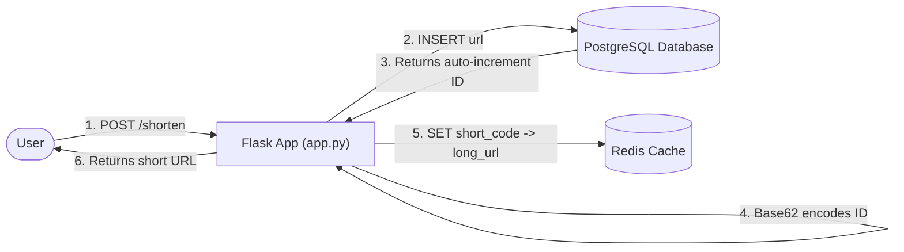
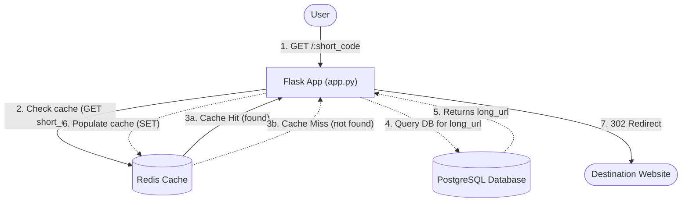

# URL Shortener Service

A fast, scalable URL shortening microservice built with **Python (Flask)**, **PostgreSQL**, and **Redis**, fully containerized with **Docker Compose**.

It converts long URLs into compact alphanumeric codes using a **Base62** encoding algorithm, leverages **Redis** for fast in-memory caching and IP-based rate limiting, and persists all mappings reliably in **PostgreSQL**.

---

## Architecture & Features

- **Base62 Short Codes**: Auto-incrementing database IDs are converted into base-62 strings (`0-9`, `a-z`, `A-Z`) yielding compact, collision-free short URLs.
- **Cache-Aside Pattern (Redis)**: Redirect requests first query Redis. Cache misses fall back to PostgreSQL and subsequently warm the cache.
- **IP-Based Rate Limiting**: Redis-backed rate limiting protects the `/shorten` endpoint (default: 10 requests / 60 seconds per IP).
- **Persistent Storage (PostgreSQL)**: Durable storage for URL mappings and auto-increment keys.
- **Containerized & Orchestrated**: Zero-config deployment with Docker Compose, including startup health checks.

### System Architecture Flows

The service implements the **Cache-Aside pattern**, where the **Flask application** orchestrates all communication between the client, Redis, and PostgreSQL (the databases never communicate directly with each other):

#### 1. URL Shortening Flow (Write Path)
When a user submits a long URL:


#### 2. URL Redirection Flow (Read Path / Cache-Aside)
When a user visits a shortened link:


---

## Project Structure

```text
url-shortener/
├── app/
│   ├── app.py              # Main Flask application (routes, Base62 logic, rate limiter)
│   ├── Dockerfile          # Container image definition for Flask web service
│   ├── init.sql            # Database schema initialization script for PostgreSQL
│   └── requirements.txt    # Python package dependencies
├── docker-compose.yml      # Multi-container orchestration (web, db, redis)
└── README.md               # Project documentation
```

---

## Getting Started

### Prerequisites

- [Docker](https://docs.docker.com/get-docker/) & [Docker Compose](https://docs.docker.com/compose/)

*(Optional for manual run without Docker: Python 3.12+, PostgreSQL 16, Redis 7)*

---

### Running with Docker Compose (Recommended)

1. **Start all services**:
   ```bash
   docker compose up --build
   ```
   To run in the background (detached mode):
   ```bash
   docker compose up -d --build
   ```

2. **Verify running containers**:
   ```bash
   docker compose ps
   ```

3. **Check the logs**:
   ```bash
   docker compose logs -f web
   ```

4. **Stop the services**:
   ```bash
   docker compose down
   ```
   *(To also remove PostgreSQL data volumes, add `-v`: `docker compose down -v`)*

---

### Local Development (Without Docker)

If you have Redis and PostgreSQL running natively or locally:

1. **Set up Python virtual environment**:
   ```bash
   cd app
   python -m venv venv
   # On Windows:
   .\venv\Scripts\activate
   # On macOS/Linux:
   source venv/bin/activate
   ```

2. **Install dependencies**:
   ```bash
   pip install -r requirements.txt
   ```

3. **Set environment variables**:
   ```bash
   # Windows PowerShell
   $env:REDIS_HOST="localhost"
   $env:REDIS_PORT="6379"
   $env:POSTGRES_HOST="localhost"
   $env:POSTGRES_DB="urlshortener"
   $env:POSTGRES_USER="postgres"
   $env:POSTGRES_PASSWORD="your_password"

   # Linux/macOS
   export REDIS_HOST="localhost"
   export REDIS_PORT="6379"
   export POSTGRES_HOST="localhost"
   export POSTGRES_DB="urlshortener"
   export POSTGRES_USER="postgres"
   export POSTGRES_PASSWORD="your_password"
   ```

4. **Initialize database schema**:
   Run the SQL statements from `app/init.sql` against your PostgreSQL instance:
   ```sql
   CREATE TABLE IF NOT EXISTS urls (
       id SERIAL PRIMARY KEY,
       long_url TEXT NOT NULL,
       created_at TIMESTAMP DEFAULT CURRENT_TIMESTAMP
   );
   ```

5. **Start Flask server**:
   ```bash
   python app.py
   ```
   The service will listen on `http://localhost:5000`.

---

## API Documentation

### 1. Health Check
Check the health status of the application.

- **URL**: `/health`
- **Method**: `GET`
- **Response**: `200 OK`
  ```json
  {
    "status": "healthy"
  }
  ```

**Example Request:**
```bash
curl -X GET http://localhost:5000/health
```

---

### 2. Shorten URL
Takes a destination URL and returns a shortened URL along with the short code.

- **URL**: `/shorten`
- **Method**: `POST`
- **Rate Limit**: 10 requests per 60 seconds per IP address
- **Headers**: `Content-Type: application/json`
- **Request Body**:
  ```json
  {
    "url": "https://www.example.com/very/long/url/path?param=value"
  }
  ```

- **Success Response**: `201 Created`
  ```json
  {
    "short_code": "1",
    "short_url": "http://localhost:5000/1"
  }
  ```

- **Error Responses**:
  - `400 Bad Request`: If request body or `url` field is missing.
    ```json
    { "error": "Missing url field" }
    ```
  - `429 Too Many Requests`: If client exceeds 10 requests per 60 seconds.
    ```json
    { "error": "Rate limit exceeded. Try again later." }
    ```

**Example Request:**
```bash
curl -X POST http://localhost:5000/shorten \
  -H "Content-Type: application/json" \
  -d '{"url": "https://en.wikipedia.org/wiki/URL_shortening"}'
```

---

### 3. Redirect to Original URL
Resolves the short code and performs an HTTP redirect (`302 Found`) to the original URL.

- **URL**: `/:short_code`
- **Method**: `GET`
- **Responses**:
  - `302 Found`: Redirects to destination URL (with `Location` header).
  - `404 Not Found`: If short code does not exist.
    ```json
    { "error": "Short URL not found" }
    ```

**Example Request (in browser or curl):**
```bash
# Follow redirects with -L
curl -i -L http://localhost:5000/1
```

---

## Configuration & Environment Variables

The web service can be configured via environment variables:

| Variable | Default (Docker) | Description |
| :--- | :--- | :--- |
| `REDIS_HOST` | `redis` | Hostname or IP of the Redis server |
| `REDIS_PORT` | `6379` | Port for Redis connection |
| `POSTGRES_HOST` | `db` | Hostname or IP of the PostgreSQL server |
| `POSTGRES_DB` | `urlshortener` | PostgreSQL database name |
| `POSTGRES_USER` | `postgres` | PostgreSQL username |
| `POSTGRES_PASSWORD` | `postgres` | PostgreSQL password |

---

## How It Works

### Base62 Encoding
Instead of hashing strings (e.g. MD5/SHA256 which require collision handling and truncation), this service uses numeric **Base62 conversion**:
1. When a URL is submitted, it is inserted into the PostgreSQL `urls` table, which assigns a unique auto-incrementing integer `id`.
2. The integer ID is converted into Base62 using character set `[0-9a-zA-Z]`.
   - `id = 1` $\rightarrow$ `1`
   - `id = 61` $\rightarrow$ `Z`
   - `id = 62` $\rightarrow$ `10`
   - `id = 125` $\rightarrow$ `21`
3. With 6 alphanumeric characters, Base62 can represent up to $62^6 \approx 56.8 \text{ billion}$ distinct URLs.

### Caching Strategy
- **Write Path**: When a URL is shortened, the `(short_code -> long_url)` pair is immediately written to Redis.
- **Read Path**: When `GET /:short_code` is requested, the application checks Redis first (`O(1)` memory lookup). If not found, it decodes the code back to the integer ID, queries PostgreSQL, and caches the result in Redis for subsequent requests.

### Rate Limiting
- The `@rate_limit(max_requests=10, window=60)` decorator uses Redis atomic pipeline operations (`INCR` and `EXPIRE`) tracking client IPs (`rate_limit:<client_ip>`), protecting the `/shorten` endpoint against spam and abuse.

